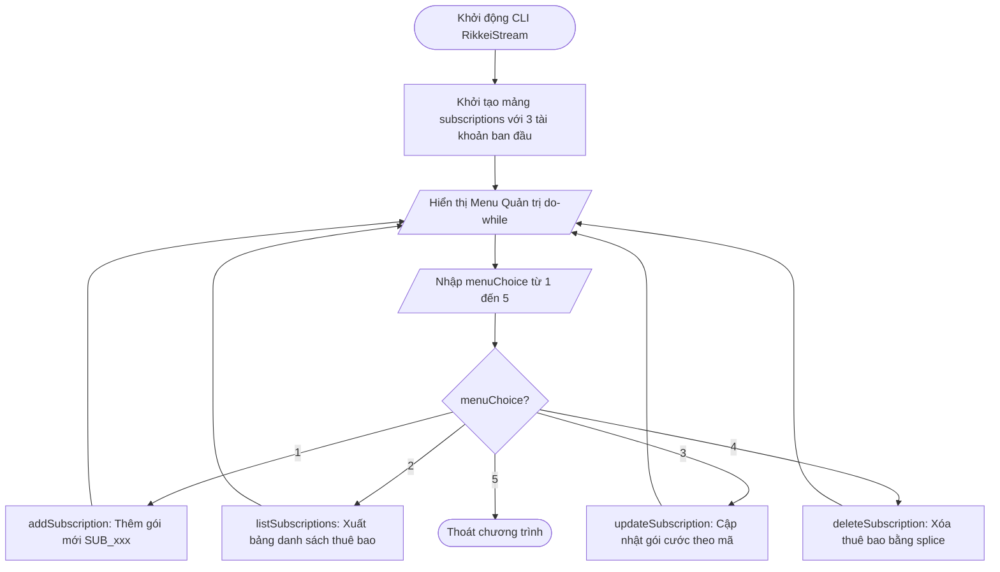

# BÁO CÁO BÀI TẬP: XÂY DỰNG ỨNG DỤNG CONSOLE MENU CRUD QUẢN LÝ THUÊ BAO CLOUD

> 👤 **Học viên:** Hoàng Công Dũng | **Mã SV:** PTIT-HCM-009
> 🏫 **Môn học:** it103b-rl-HoangCongDung

---

## 📊 Sơ đồ thiết kế hệ thống (Flowchart)

> 💡 *Sơ đồ dưới đây được render tự động trực tiếp trên GitHub bằng Mermaid. Bạn cũng có thể tải file **`bt2.drawio`** trong repository này để mở và chỉnh sửa trực tiếp trên [Draw.io (diagrams.net)](https://app.diagrams.net).* 

---

## 1. Mục tiêu và Ngữ cảnh bài toán

Bài tập này yêu cầu tự xây dựng một ứng dụng dòng lệnh CLI hoàn chỉnh bằng Javascript để quản lý vòng đời thuê bao SaaS cho nền tảng RikkeiStream.

Chương trình phải đảm bảo tính mô đun hóa cao, tách bạch rõ ràng các chức năng CRUD thành từng hàm độc lập và sử dụng vòng lặp do-while kết hợp switch-case để điều hướng trải nghiệm người dùng mượt mà.

- Khởi tạo sẵn ít nhất 3 tài khoản trong mảng subscriptions để kiểm thử.
- Tự động sinh mã định danh duy nhất theo định dạng 'SUB_xxx' cho các thuê bao mới.
- Định dạng kết quả xuất ra dạng bảng thẳng hàng chuyên nghiệp trên Console.

## 2. Phân tích Quy tắc Nghiệp vụ và Xử lý Bẫy Dữ liệu

Trong quá trình hiện thực hóa các hàm CRUD, tôi đã xây dựng các cơ chế kiểm tra dữ liệu đầu vào cẩn thận nhằm tránh các lỗi phát sinh khi người dùng nhập sai cú pháp hoặc tìm kiếm không thấy mã thuê bao.

Cụ thể, hàm cập nhật và xóa bắt buộc phải thực hiện bước tìm kiếm vị trí phần tử trong mảng dựa vào mã thuê bao do người dùng cung cấp.

- Thêm mới: Bắt buộc chọn đúng gói cước hợp lệ giữa 'PERSONAL' và 'FAMILY', đồng thời tự động tăng chỉ số mã thuê bao.
- Cập nhật: Cho phép nhập mã thuê bao cần sửa, nếu tìm thấy sẽ tiến hành cập nhật lại tên và gói cước cùng hạn mức thiết bị tương ứng.
- Xóa: Sử dụng phương thức splice() để cắt bỏ chính xác phần tử khỏi mảng subscriptions khi tìm thấy mã khớp.

## 3. Bảng đặc tả chi tiết chức năng CRUD

Dưới đây là bảng phân tích logic hoạt động của các chức năng trong ứng dụng Console Menu:

| Chức năng | Tên hàm | Thao tác xử lý chính | Kết quả đầu ra |
| --- | --- | --- | --- |
| 1. Thêm mới | addSubscription() | Nhập tên, chọn gói cước, sinh mã 'SUB_xxx' | Thêm object mới vào mảng subscriptions |
| 2. Xem danh sách | listSubscriptions() | Duyệt mảng và in định dạng bảng console.table() | Hiển thị toàn bộ thông tin thuê bao trực quan |
| 3. Cập nhật | updateSubscription() | Tìm kiếm theo mã, nhập thông tin mới thay thế | Cập nhật thành công gói cước và hạn mức |
| 4. Hủy thuê bao | deleteSubscription() | Tìm index theo mã, dùng splice() xóa khỏi mảng | Loại bỏ hoàn toàn thuê bao khỏi hệ thống |
| 5. Thoát | Menu do-while | Kiểm tra điều kiện chọn số 5 | Kết thúc vòng đời chương trình CLI |

## 4. Hướng dẫn kiểm thử và Triển khai mã nguồn

Mã nguồn được hoàn thiện và lưu tại file 'solution_ex7.js', tuân thủ tuyệt đối quy định đặt tên và cấu trúc thư mục của tổ chức GitHub 'it103b-rl-HoangCongDung'.

Có thể chạy trực tiếp file trên môi trường Node.js bằng lệnh 'node solution_ex7.js' để kiểm tra toàn bộ các tính năng menu tương tác.

---

## 📁 Danh sách tệp tin nộp bài trong Repository
- 📝 `bt2.docx`: Báo cáo tài liệu phân tích nghiệp vụ hoàn chỉnh.
- 🎨 `bt2.drawio`: File thiết kế sơ đồ chuẩn theo quy định đề bài (mở trực tiếp bằng [Draw.io](https://app.diagrams.net) hoặc Lucidchart).
- 💻 `solution_ex7.js`: Mã nguồn chương trình.
